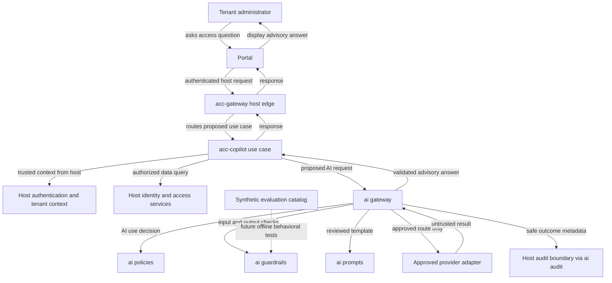
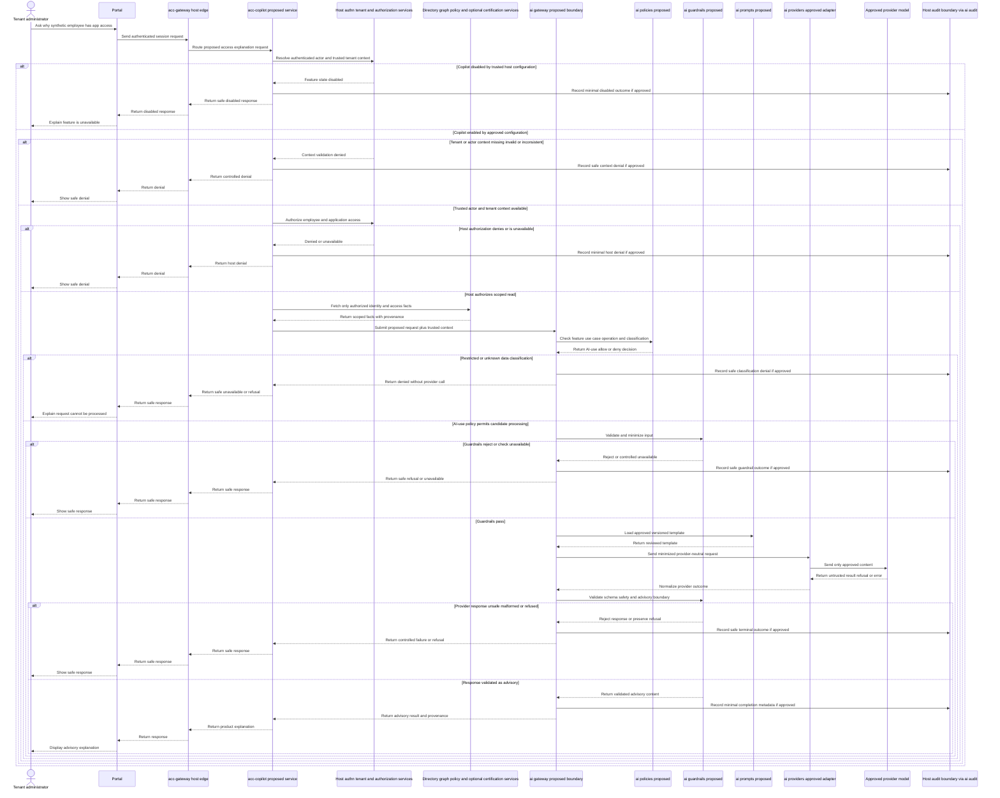

# Accidion Copilot Integration Architecture

**Status: PROPOSED — NOT APPROVED**

This document proposes how a future `acc-copilot` host service could use the reusable AI capabilities reserved under `ai/`. It does not assert that a service, API, interface, provider, policy engine, guardrail, audit integration, portal, or runtime has been implemented or approved. It does not change ADR status or enable Accidion AI Copilot. The product Copilot remains disabled by default.

All interfaces and examples below are logical proposals, not existing APIs. Values in examples are synthetic.

## 1. Repository findings and current status

The repository has service directory placeholders for `services/acc-copilot`, `services/acc-gateway`, `services/acc-authn`, `services/acc-tenant`, `services/acc-directory`, `services/acc-graph`, `services/acc-policy`, and `services/acc-cert`. These directories contain `.gitkeep` placeholders only; no service source, API specification, or host-service contract was found. No portal implementation was found in the inspected repository paths.

The `ai/` tree contains governance and proposed-design documents, five synthetic evaluation case descriptions, and an offline structural catalog validator under `scripts/validate/` with unit tests under `tests/unit/`. The validator checks case-file structure; it does not exercise a model or runtime guardrail.

Relevant status:

- `ai/gateway/CONTRACTS.md`, `ai/providers/PROVIDER_INTERFACE.md`, `ai/policies/POLICY_ENGINE.md`, `ai/guardrails/README.md`, and `ai/evaluations/HARNESS_DESIGN.md` are design/policy documents, not runtime implementations.
- `ai/guardrails/` has a proposed README and placeholders; `ai/audit/`, `ai/prompts/`, and `ai/providers/` have placeholders only.
- `services/acc-copilot/`, `services/acc-gateway/`, and the named host services are reserved paths, not demonstrated deployables.
- ADR-007 remains Proposed, pending Product, Security, and Architecture approval. ADR-008 remains Proposed, pending Product and Delivery approval.
- There are no existing `acc-copilot` or `acc-gateway` APIs to rely on. Names and responsibilities in this document are proposed boundaries only.

The exact six-month plan is not present as a separate planning document in the inspected repository; `docs/engineering/implementation-plan/README.md` states the planning window and points to a planning baseline, while ADR-008 says MVP scope must be decided by the six-month plan. Product/Delivery must identify the authoritative plan and approve whether Copilot is MVP scope.

## 2. Architecture overview

### Component placement

- **Portal:** Presents a user interaction and forwards an authenticated request to the host edge. No portal implementation or API contract was found.
- **`acc-gateway` (host edge gateway):** Proposed ingress boundary for routing requests to host services. It is not the same thing as `ai/gateway/`. Authentication integration and transport are not specified by current contracts.
- **`acc-copilot` (product use-case service):** Proposed host-side orchestrator for the product-specific “explain this employee’s application access” use case. It should own the business flow and compose authorized host facts; it should not implement provider SDK logic, reusable guardrails, or its own parallel policy system.
- **Host services:** Proposed sources of authentication/tenant context and authoritative identity/access/policy data. They remain the source of truth and authorization authority.
- **`ai/gateway/` (reusable AI boundary):** Proposed library/service boundary that validates AI requests, enforces feature/policy/guardrail decisions, routes only approved provider profiles, validates responses, and returns an advisory result. It is distinct from the user-facing/host `services/acc-gateway`.
- **`ai/policies/` and `ai/guardrails/`:** Proposed deterministic AI-use policy and reusable input/output safety controls. Neither replaces host authorization.
- **`ai/prompts/`:** Proposed location for reviewed and versioned prompt templates. User-supplied content remains untrusted data.
- **`ai/providers/`:** Proposed provider-neutral adapter implementations. Provider/model selection must be from approved trusted configuration, not request fields.
- **`ai/audit/`:** Proposed mapping of guardrail/Gateway outcomes to the approved host audit boundary; it is not a new independent source of audit authority.
- **`ai/evaluations/`:** Synthetic case catalog plus a proposed behavioral evaluation design. The current executable validator checks only catalog structure.

### Recommended service boundary

**Is `acc-copilot` a separate deployable backend service today? No evidence establishes that.** `services/acc-copilot/` is a placeholder, not a working deployable. ADR-008 warns against creating deployable services for deferred scope.

**Proposed design:** If Product/Delivery approves the use case for the MVP and Architecture approves ownership, treat `acc-copilot` as a product-specific backend/service boundary that owns the access-explanation workflow. Whether it is deployed separately or packaged with another host service must be decided from the actual host topology and operational requirements; this document does not mandate a new deployable. It should call the reusable AI Gateway boundary rather than embedding provider calls or AI safety logic into the Copilot service.

### Proposed logical architecture

<!-- mermaid-checked: no \n, no em-dash/en-dash, no {} in labels, subgraphs are id["label"], arrows are -->|"label"|, all subgraphs closed by end, ids unique -->


This diagram is a target proposal, not an implementation graph. In particular, it does not define whether `ai/gateway/` is an in-process package or a separately deployed internal service.

## 3. Component responsibility and status

“Implemented” refers only to repository evidence, not to a production deployment. A folder name or design document alone is not implementation evidence.

| Component | Responsibility in the proposed design | Input | Output | Dependencies | Current status |
|---|---|---|---|---|---|
| Portal | Collect user question and show safe advisory response | Authenticated user interaction | Access-explanation request/result | Portal identity/session integration; host edge | Missing in inspected repository; no portal implementation found |
| `services/acc-gateway` | Host ingress/routing boundary; forwards authenticated request to authorized host use case | Portal request and authenticated host session | Host response | Authn/tenant trust integration; service routing | Missing; placeholder only |
| `services/acc-copilot` | Own access-explanation business flow and coordinate host reads plus AI request | User task, trusted host context, authorized evidence | Product-specific explanation response | Host authz and data services; reusable AI Gateway | Missing; placeholder only |
| `services/acc-authn` | Authenticate actor and establish authenticated principal/session | Credentials/session/token at approved host boundary | Authenticated actor context | Host identity/session architecture | Missing; placeholder only |
| `services/acc-tenant` | Resolve tenant membership/scope from trusted identity | Authenticated principal | Trusted tenant scope | Authn and tenant authority | Missing; placeholder only |
| `services/acc-directory` | Proposed source of employee/identity attributes | Authorized identity query | Scoped identity facts | Host authorization and tenant scope | Missing; placeholder only |
| `services/acc-graph` | Proposed source of application, entitlement, and identity-access relationships | Scoped graph query | Access relationship facts and provenance | Host authorization and tenant scope | Missing; placeholder only |
| `services/acc-policy` | Authoritative deterministic access/SoD policy evaluation | Authorized access facts and policy context | Host policy result | Host policy data and tenant scope | Missing; placeholder only |
| `services/acc-cert` | Provide certification/review context only if this use case requires it | Authorized certification query | Scoped review state | Host authorization and certification workflow | Missing; placeholder only |
| `ai/gateway/` | Reusable AI request boundary, policy/guardrail orchestration, routing, response normalization | Proposed request plus trusted host context and authorized context | Validated advisory result or safe failure | Policies, guardrails, prompts, approved provider adapter, audit | Proposed contract only; no runtime implementation |
| `ai/policies/` | Decide AI-use eligibility, classification, route and operation constraints | Trusted context and request metadata | Versioned AI-use allow/deny decision | Approved use-case policy and provider approval records | Proposed policy document only |
| `ai/guardrails/` | Reusable deterministic input/output safety checks and refusal handling | Normalized input or provider result | Pass/reject/refuse plus safe reason | Approved contracts, classification and host controls | Proposed README and plan only; no runtime implementation |
| `ai/providers/` | Isolate provider-specific protocol behind approved adapter | Minimized provider-neutral request | Untrusted normalized provider result/refusal/error | Separately approved provider/model and secret configuration | Proposed interface document only; no adapter |
| `ai/prompts/` | Store reviewed, versioned use-case templates | Approved template ID and bounded variables | Rendered instruction with untrusted content separated | Prompt review/version policy | Placeholder only; no prompt registry/templates |
| `ai/audit/` | Emit privacy-minimized AI decision/outcome metadata to host audit | Safe decision and correlation metadata | Host audit event/result | Approved host audit schema, access and retention rules | Placeholder only; no integration |
| `ai/evaluations/` | Store synthetic cases and, in future, execute behavioral regressions | Synthetic cases and approved test adapter | Test evidence and bounded outcomes | Future runner, assertions, test doubles; provider only if separately approved | Partial: cases and design exist; offline structural validator is implemented; no behavioral runner |

`identity` in the user’s example is represented by authenticated actor context and directory identity facts in this proposal. No distinct `acc-identity` service directory or identity API contract was found. `acc-cert` should not be queried unless certification state is necessary and authorized for the approved use case.

## 4. End-to-end request flow

Example user question: “Explain why this employee has access to a particular application.”

The proposed order deliberately obtains host authorization before retrieving identity/access facts, checks the Copilot feature state before any AI/provider call, and checks classification before provider transmission. The host—not the AI policy—decides whether the requester may read the relevant employee and access data.

<!-- mermaid-checked: sequence diagram uses explicit participants and quoted messages; all rejection branches are closed; no implementation status is implied -->


This diagram is a proposed logical flow. It does not define transport, endpoints, serialization, deployable boundaries, or existing service calls. Audit failure behavior must be decided before implementation; “if approved” is not a decision to silently drop required audit.

## 5. Proposed integration contracts

These are illustrative shapes only. They are not existing endpoint schemas, and they do not imply that a service is deployed. Field names and versioning require review before implementation.

### 5.1 Copilot request from the host edge

The portal may submit a user task and opaque resource references, but it must not establish trusted tenant/actor authority. The edge attaches or passes authenticated context only through a protected server-to-server mechanism to be designed.

```json
{
  "schema_version": "proposed-v1",
  "request_id": "req-synth-1001",
  "use_case": "explain-application-access",
  "employee_ref": "employee-synth-17",
  "application_ref": "application-synth-4",
  "question": "Explain why this employee has access to this application."
}
```

### 5.2 Trusted tenant and actor context

Created from the authenticated host context; never trusted from request text or a browser field.

```json
{
  "tenant_ref": "tenant-synth-blue",
  "actor_ref": "actor-synth-admin-3",
  "caller_service": "acc-copilot",
  "authorization_ref": "authz-synth-220",
  "correlation_id": "corr-synth-1001",
  "authenticated_at": "2026-11-10T08:00:00Z"
}
```

### 5.3 Host authorization result

An authorization reference is evidence/trace metadata; it is not a token the AI system can reinterpret or use to widen access.

```json
{
  "decision": "allow",
  "tenant_ref": "tenant-synth-blue",
  "actor_ref": "actor-synth-admin-3",
  "resource_refs": [
    "employee-synth-17",
    "application-synth-4"
  ],
  "action": "read-access-explanation-evidence",
  "authorization_ref": "authz-synth-220"
}
```

### 5.4 Authorized host evidence

Only the facts the host authorized for this question are provided. Host policy remains distinct from AI-use policy.

```json
{
  "employee_ref": "employee-synth-17",
  "application_ref": "application-synth-4",
  "access_basis": [
    {
      "source": "group-membership",
      "label": "group-synth-finance",
      "granted_entitlement": "application-reader"
    }
  ],
  "host_policy_result_ref": "policy-synth-71",
  "data_classification": "Internal",
  "source_refs": [
    "directory-synth-17",
    "graph-synth-17"
  ]
}
```

### 5.5 AI policy decision

An AI `allow` means only that the AI-use conditions permit continuing to the next control; it is never host resource authorization.

```json
{
  "decision": "allow",
  "reason_codes": [],
  "policy_version": "ai-policy-synth-v1",
  "allowed_operation": "reason",
  "data_classification": "Internal",
  "provider_profile_ref": "profile-synth-approved",
  "human_review_required": true
}
```

### 5.6 Guardrail result

```json
{
  "status": "pass",
  "input_minimized": true,
  "classification_allowed": true,
  "output_contract": "access-explanation-synth-v1",
  "reason_codes": []
}
```

If a guardrail denies or is unavailable, the result must be a non-success status, and provider invocation must not occur.

### 5.7 Provider request and response

Provider selection is performed only by the AI Gateway from trusted approved configuration. No caller-supplied provider, model, endpoint, or region is accepted.

```json
{
  "interface_version": "proposed-v1",
  "request_id": "req-synth-1001",
  "capability_profile": "profile-synth-approved",
  "operation": "reason",
  "task": "Explain the supplied access basis without making an authorization decision.",
  "context": {
    "employee_label": "employee-synth-17",
    "application_label": "application-synth-4",
    "access_basis": "Membership in group-synth-finance grants application-reader."
  },
  "data_classification": "Internal",
  "output_format": "access-explanation-synth-v1",
  "deadline": "2026-11-10T08:00:10Z"
}
```

Illustrative normalized provider response, which remains untrusted until validated:

```json
{
  "interface_version": "proposed-v1",
  "request_id": "req-synth-1001",
  "outcome": "completed",
  "content": {
    "explanation": "The synthetic access record shows membership in group-synth-finance, which grants application-reader.",
    "advisory": true
  },
  "capabilities_used": [
    "text_generation"
  ]
}
```

### 5.8 Audit event

Use the approved host audit boundary and schema; do not create a separate source of truth or log raw prompt/response data by default.

```json
{
  "event_type": "ai.guardrail.completed",
  "request_id": "req-synth-1001",
  "correlation_id": "corr-synth-1001",
  "tenant_ref": "tenant-synth-blue",
  "actor_ref": "actor-synth-admin-3",
  "use_case": "explain-application-access",
  "policy_version": "ai-policy-synth-v1",
  "outcome": "completed_advisory",
  "data_classification": "Internal",
  "provider_profile_ref": "profile-synth-approved",
  "raw_content_recorded": false
}
```

### 5.9 Copilot response to host edge

```json
{
  "schema_version": "proposed-v1",
  "request_id": "req-synth-1001",
  "status": "completed",
  "answer": {
    "explanation": "The synthetic access record shows membership in group-synth-finance, which grants application-reader."
  },
  "advisory": true,
  "action_taken": false,
  "human_review_required": true,
  "source_refs": [
    "directory-synth-17",
    "graph-synth-17"
  ]
}
```

For all denied/unavailable/disabled outcomes, return a safe status and reason code without protected details. Do not present an AI-use policy denial as an authorization decision, and do not expose host authorization internals unnecessarily.

## 6. Trust and security boundaries

1. **User/portal to host edge:** User input and client fields are untrusted. The portal cannot set authoritative tenant or actor identity.
2. **Host identity and authorization:** Authentication, tenant membership, resource authorization, deterministic access/SoD policy, and workflow state are controlled by host services. The AI path cannot grant or override them.
3. **Host to Copilot:** A future protected internal boundary must convey authenticated actor, tenant, caller, correlation, and authorization context. The mechanism is undecided and must not be inferred from the proposed JSON examples.
4. **Copilot to host data services:** Copilot requests only minimum evidence after authorization. Directory, graph, policy, and certification services remain authoritative for their own data and decisions.
5. **Copilot to AI Gateway:** Copilot supplies a registered use case and authorized minimized evidence. User-provided content is untrusted; actor and tenant context remain host-supplied.
6. **AI Gateway to policy/guardrails:** AI policy is a narrower use-eligibility check. Guardrails perform deterministic request/response validation and fail closed. Neither is a replacement for host authorization.
7. **AI Gateway to provider:** Only an approved trusted route may transmit approved data classes. Restricted data must never be sent to a provider. Provider/model approval is per use case and data class; an approved provider is not globally approved for all content.
8. **Provider response to application:** Treat response and provenance as untrusted. Validate schema, bounds, refusal/error status, advisory-only properties, and source references before returning it.
9. **Audit:** Record only approved minimal metadata through the host boundary. Define retention, access, integrity, and audit-outage behavior before runtime work.
10. **Evaluation:** Keep fixtures synthetic. Structural validation is not behavioral evaluation. Provider-backed evaluations require separate approvals and must not enable product Copilot.

## 7. Failure and rejection scenarios

| Condition | Required behavior | Provider call? |
|---|---|---|
| Copilot disabled, missing flag, or invalid flag state | Return controlled disabled/unavailable result; default remains off. | No |
| Tenant/actor context missing, malformed, conflicting, or untrusted | Reject before host data access or AI routing. | No |
| Host authorization denies or is unavailable | Host denial wins; do not retrieve protected evidence or invoke AI. | No |
| Restricted or unknown data classification | Deny provider processing before serialization/transmission; never downgrade classification. | No |
| AI policy denies, is stale, or cannot be evaluated | Deny/unavailable; an error cannot become allow. | No |
| Input guardrail rejects or is unavailable | Refuse/unavailable and audit safely under the approved policy. | No |
| Provider refusal | Preserve explicit refusal; do not retry around it or silently substitute another provider. | Already called |
| Provider response malformed, unsafe, oversized, or mismatched | Reject as controlled failure; do not pass to host workflow or treat as success. | Already called |
| Audit boundary unavailable | Apply a preapproved audit-availability policy; do not silently drop mandatory audit or log sensitive content as fallback. | Depends on approved policy; not decided |
| Host data service timeout/error | Return controlled unavailable response; do not invent facts or continue with incomplete authoritative data. | No |

Every response to the user is informational and advisory. None of these paths may approve access, modify entitlements, provision an account, or execute privileged operations.

## 8. Evaluations and tests

### Current evidence

- Five synthetic case files cover prompt injection, tenant isolation, sensitive-data leakage, unsafe access recommendations, and malformed output.
- `scripts/validate/ai_evaluation_cases.py` validates catalog shape; `tests/unit/test_ai_evaluation_cases.py` tests that validator.
- `ai/evaluations/HARNESS_DESIGN.md` describes a future behavioral harness, but does not implement one.
- No Copilot, host authorization, gateway, policy, guardrail, provider, audit, portal integration, or behavioral evaluation tests were found.
- The checked-in `.github/workflows/verify.yml` runs `make verify`, whose current target only runs repository structure validation; it does not run the AI catalog validator or unit tests.

### Required future test layers

- Unit tests for policy and guardrail decisions, including disabled defaults, invalid context, classification, redaction, response schema, refusal, and fail-closed errors.
- Contract tests for host-to-Copilot and Copilot-to-AI-Gateway boundaries after they are approved.
- Tenant-isolation tests that prove denial happens before retrieval/provider invocation.
- Provider adapter tests with local test doubles; no live provider dependency by default.
- Behavioral tests mapped from each synthetic case to explicit deterministic assertions; inconclusive and skipped results must not count as passing.
- Audit privacy tests proving raw prompts, responses, markers, and sensitive identity data do not enter logs or reports.
- Portal flow tests proving users see only a safe advisory result and no action is triggered.
- CI execution only after maintainer approval for workflow changes.

## 9. Phased implementation roadmap

Every path below is a proposed destination or existing planning reference, not authorization to create a service, API, dependency, or runtime. Confirm existing host language/build/test conventions and approvals before implementation.

### P0 — Resolve ADR-007/ADR-008 and AI MVP scope

- **Paths:** `docs/engineering/adr/ADR-007-decision-topic.md`, `docs/engineering/adr/ADR-008-decision-topic.md`, and the authoritative six-month plan identified by Product/Delivery.
- **Dependencies:** Named Product, Delivery, Security, and Architecture decision owners.
- **Acceptance criteria:** Copilot’s MVP status (in-scope or deferred), first use case, owners, users, data classes, and measurable acceptance criteria are explicitly approved; ADR statuses are changed only by the authorized approval process. Until then, Copilot remains disabled.

### P1 — Define the `acc-copilot` boundary and contracts

- **Paths:** `services/acc-copilot/` (currently placeholder), `services/acc-gateway/` (currently placeholder), `ai/gateway/CONTRACTS.md`, `ai/providers/PROVIDER_INTERFACE.md`, and this document.
- **Dependencies:** P0; Architecture and Security approval; host service ownership and deployment topology.
- **Acceptance criteria:** Decide whether Copilot is a separately deployable service or a host module; document authenticated host-to-Copilot and Copilot-to-AI-Gateway contracts, request/response ownership, error semantics, and context integrity. No contracts or runtime APIs are changed by this plan.

### P2 — Implement default-disabled and host authorization integration

- **Paths:** Approved implementation files under `services/acc-copilot/`, integration points under `services/acc-gateway/`, and host authn/tenant/authorization service contracts once they exist.
- **Dependencies:** P1 contracts; host authentication, tenant, authorization and data-access implementations; maintainer approval for security-boundary changes.
- **Acceptance criteria:** Feature defaults to disabled; authenticated tenant/actor context is host-derived; host authorization runs before data retrieval and AI calls; denied or unavailable authorization causes no AI/provider call; no client-supplied tenant ID is trusted.

### P3 — Implement AI policy and guardrail enforcement

- **Paths:** Runtime implementation candidates under `ai/policies/` and `ai/guardrails/`; approved Gateway integration under `ai/gateway/`; existing proposals `ai/policies/POLICY_ENGINE.md` and `ai/guardrails/README.md` remain design references.
- **Dependencies:** P0/P1 approvals; platform classification authority; approved use-case registration and output schema.
- **Acceptance criteria:** Registered capabilities only; Restricted/missing/unknown classification denied before provider call; minimized input; input/output validation; prompt injection treated as untrusted data; fail-closed errors; no autonomous action capability; human review requirements carried to the host.

### P4 — Implement approved provider and prompt integration

- **Paths:** `ai/providers/`, `ai/prompts/`, and the approved `ai/gateway/` routing implementation.
- **Dependencies:** Provider/model, data-processing, region, retention, privacy, security, architecture, operations and secret-management approvals; P3 controls.
- **Acceptance criteria:** Provider is selected only from trusted approved configuration; route is explicitly approved for exact use case/data class; prompts are reviewed/versioned; provider errors/refusals are normalized; no Restricted or unapproved data is transmitted; no direct provider calls from Copilot.

### P5 — Implement audit integration and response safety

- **Paths:** `ai/audit/`, host audit integration, Copilot response mapping under `services/acc-copilot/`, and Gateway output validation.
- **Dependencies:** Approved host audit schema, access/retention/integrity rules, audit outage policy, P3/P4 contracts.
- **Acceptance criteria:** Decisions and terminal statuses emit minimal approved metadata; sensitive content is not logged by default; unsafe/malformed output is rejected; safe errors do not reveal provider internals; advisory and no-action properties are enforced; audit outage behavior is tested.

### P6 — Add unit, contract, tenant-isolation, adversarial and behavioral evaluation tests

- **Paths:** `tests/unit/`, `tests/contract/`, `tests/tenant-isolation/`, `tests/integration/`, `ai/evaluations/cases/`, and a future approved runner under `ai/evaluations/` or `scripts/`.
- **Dependencies:** Implemented contracts and controls from P2-P5; synthetic test doubles; reviewed deterministic assertion mapping; maintainer approval before CI changes.
- **Acceptance criteria:** Tests cover disabled behavior, context forgery, host authorization denial, Restricted data, injection, leakage, unsafe recommendation, malformed/refused provider output, audit/log privacy, timeouts, and no action dispatch. Structural validation is reported separately from behavioral evidence. No unapproved provider calls or invented thresholds.

### P7 — Integrate with the portal and approved CI/CD process

- **Paths:** Portal source location (not found in the inspected repository), `services/acc-gateway/`, `.github/workflows/verify.yml`, and `Makefile`.
- **Dependencies:** P0-P6; portal and service ownership; Product/Security/Architecture/Operations approval; maintainer approval for CI/security-gate changes.
- **Acceptance criteria:** Portal uses the approved authenticated host flow; responses are clearly advisory and render safely; disabled state and rollback are operationally verified; approved offline tests run in CI; any provider-backed evaluation remains separately controlled and cannot enable product Copilot.

## 10. Decision checklist before implementation

- [ ] Product and Delivery approve whether this use case is in the six-month MVP and identify its owner.
- [ ] ADR-007 and ADR-008 approvals are resolved by the named decision owners.
- [ ] Architecture decides service/deployment ownership for `acc-copilot` and the distinction from `acc-gateway`.
- [ ] Security approves trusted tenant/actor context provenance and host authorization sequencing.
- [ ] Product and Security approve the access-explanation use case and the exact authorized evidence it may use.
- [ ] Data Governance/Privacy approves classification mapping, minimization, retention, and provider data handling.
- [ ] Architecture/Security approve the AI Gateway, policy, and guardrail contracts.
- [ ] Provider/model route and data classes are explicitly approved before any external call.
- [ ] Host audit owner approves schema, access, retention, integrity, and audit-outage behavior.
- [ ] Maintainer approval is obtained for changes to APIs, authorization, tenant isolation, dependencies, CI, logging, or security controls.
- [ ] Synthetic unit, contract, tenant-isolation, adversarial, and behavioral evaluation evidence is reviewed before enablement.
- [ ] Copilot remains disabled by default until the full human-controlled approval and release process is complete.

## 11. Plain-language summary

`acc-copilot` should own the product-specific job of explaining an employee’s application access. It should get identity/access facts only from host services after host authorization, then send a minimized request through the reusable `ai/gateway/` boundary. The AI Gateway would apply AI-use policy and guardrails, choose only an approved provider route, validate the result, and return an advisory answer. The host remains responsible for authorization and any actual access decision.

Today, these are mostly documented designs and empty service placeholders. The only executable AI-related feature identified is offline structural validation of the synthetic evaluation catalog; it is not a Copilot or safety runtime. The single next task is to obtain Product/Delivery’s decision on MVP scope and resolve the ADR-007/ADR-008 approval dependencies before implementation.
