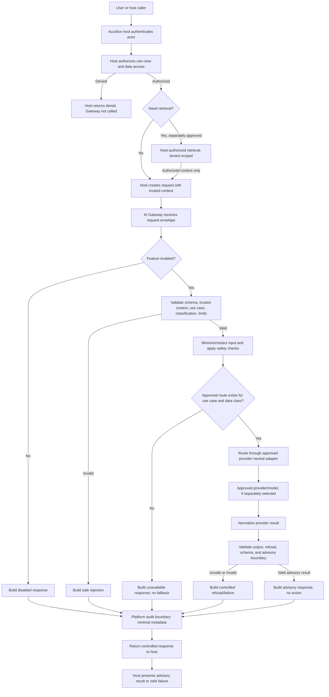

# Proposed AI Gateway Contracts

**Status: PROPOSED — NOT APPROVED**

This document proposes provider-neutral contracts and a request flow for the Accidion Identity Cloud AI Gateway. It is a design artifact only: it does not authorize implementation, provider selection, data transmission, product enablement, or a change to any ADR. The product AI Copilot remains disabled by default. All examples use synthetic data.

The design is subordinate to the repository instructions, `ai/SAFETY.md`, the architecture baseline, and accepted ADRs. Relevant AI and MVP ADRs remain proposed; this document does not approve their decisions.

## 1. Purpose and responsibilities

The Gateway is the controlled application boundary for an explicitly approved AI use case. It accepts a request from a trusted Accidion host integration, validates its shape and required trusted context, applies approved feature and use-case controls, minimizes the data forwarded, routes through an approved provider adapter, validates the result, and returns an advisory response.

The Gateway is responsible for:

- Enforcing the default-disabled feature state and rejecting unsupported use cases or operations.
- Validating request structure, data classification metadata, size limits, and required host context.
- Applying approved minimization, safety, output-validation, timeout, rate-limit, and error-handling rules.
- Calling only an explicitly approved provider adapter through a provider-neutral interface.
- Returning a normalized, advisory-only result or a controlled refusal/failure.
- Emitting privacy-aware audit metadata through the approved platform audit boundary.

The Gateway is **not** responsible for:

- Authenticating users, authorizing access to Accidion resources, or deciding whether a caller may access a subject, record, or tenant. The host Accidion platform performs authentication and authorization before invoking the Gateway.
- Establishing tenant identity from request text, caller-supplied tenant identifiers, prompts, retrieved documents, or model output.
- Replacing deterministic policy evaluation, IGA workflows, human approvals, or target-side verification.
- Provisioning, approving, changing access, invoking privileged actions, or making autonomous state changes.
- Selecting an unapproved provider, model, retrieval system, storage system, or fallback destination.

Use-case eligibility and product safety restrictions are not authorization decisions. They may reject an unsupported AI operation, but cannot grant access that the host platform denied or decide which Accidion resources the caller may see.

## 2. Provider-neutral request contract

The logical contract consists of a host-created trusted envelope and a provider-neutral request body. It is not a public user-facing API specification. Concrete serialization, transport, versioning policy, and field limits remain to be approved.

### Request envelope

| Field | Required | Meaning |
| --- | --- | --- |
| `request` | Yes | Provider-neutral `GatewayRequest` described below. |
| `trusted_context` | Yes | Context injected by the authenticated host integration, not copied from user-controlled request fields. |

### `GatewayRequest`

| Field | Required | Meaning |
| --- | --- | --- |
| `schema_version` | Yes | Contract version identifier. |
| `request_id` | Yes | Opaque request/correlation identifier generated by the host or trusted gateway boundary. Must not contain secrets or personal data. |
| `use_case` | Yes | Stable identifier for an approved, narrowly scoped use case. Unknown or unapproved identifiers are rejected. |
| `operation` | Yes | One of `observe`, `reason`, or `recommend`. It does not imply authorization or permit action execution. |
| `task` | Yes | Short task instruction limited to the approved use case; treated as untrusted data. |
| `context` | Yes | Minimum task-specific, already-authorized context supplied by the host. It must not be an unrestricted database query or a request for the Gateway to infer access rights. |
| `data_classification` | Yes | Classification assigned by the host under the platform's approved classification scheme. The Gateway does not invent a separate taxonomy. Missing, unknown, or unsupported classifications fail closed for external processing. |
| `source_refs` | No | Opaque references/provenance for context already authorized and retrieved by the host. References do not grant the Gateway permission to retrieve data. |
| `output_format` | Yes | A bounded, use-case-approved output shape identifier; not an arbitrary provider-specific schema or instruction. |
| `deadline` | Yes | Absolute request deadline or equivalent bounded budget established by the host. |
| `idempotency_key` | Recommended | Opaque host-generated key used to correlate safe retries. It does not authorize repeating an action; AI requests must have no state-changing side effects. |

### `TrustedExecutionContext`

This envelope is created or attached by trusted Accidion server-side code after ordinary authentication and authorization. It is not accepted as authoritative when supplied by a browser, user, prompt, provider, or retrieved content.

| Field | Required | Meaning |
| --- | --- | --- |
| `tenant_ref` | Yes | Opaque tenant reference from authenticated platform context. Never inferred from request content. |
| `actor_ref` | Yes | Opaque authenticated actor or service-principal reference. |
| `caller_service` | Yes | Registered host service identity invoking the Gateway. |
| `authorization_ref` | Yes | Opaque reference to the host's authorization decision/context for traceability. The Gateway does not reevaluate it or infer permissions from it. |
| `authenticated_at` | Yes | Authentication-context timestamp supplied by the host. |
| `correlation_id` | Yes | Trusted host correlation identifier for tracing across the request flow. |

The integration boundary must prevent callers from forging or overriding this context. How the host authenticates the integration and protects this envelope is a platform/API security decision, not specified here.

## 3. Provider-neutral response contract

Every response should use a stable, provider-neutral shape:

| Field | Required | Meaning |
| --- | --- | --- |
| `schema_version` | Yes | Response contract version. |
| `request_id` | Yes | Correlates with the originating request. |
| `status` | Yes | One of `completed`, `refused`, `disabled`, `rejected`, `unavailable`, or `failed`. |
| `result` | Conditional | Present only for `completed`; validated, bounded, and clearly advisory content in the approved output format. |
| `refusal` | Conditional | Present for `refused`; safe reason code and user-appropriate explanation without sensitive internal details. |
| `error` | Conditional | Present for non-user-actionable failures; stable error code and safe message. Must not expose provider internals, secrets, prompts, or protected data. |
| `provenance` | Yes | Minimal metadata such as approved use-case identifier and source references, where permitted. Does not assert model-generated claims as facts. |
| `advisory` | Yes | Always `true`; result is not an authorization, policy, approval, or execution outcome. |
| `action_taken` | Yes | Always `false`; the Gateway and AI capability do not execute actions. |
| `completed_at` | Yes | Timestamp for the terminal response. |

`completed` means only that a validated advisory result was produced. It does not mean that an access request was approved, a policy decision was made, or an operation completed. Refusals and failures must not be disguised as successful results or silently replaced with a less safe path.

## 4. Trusted tenant and authenticated actor context

The host platform authenticates the actor and authorizes access to the data and use case before it calls the Gateway. It attaches trusted tenant and actor context through a protected server-to-server integration boundary.

The Gateway may validate that required context is present, well-formed, associated with the expected caller, and internally consistent. These are input-integrity checks, **not authorization decisions**. It must not:

- Accept a tenant identifier in the user-facing request as trusted context.
- Treat a supplied `authorization_ref` as permission to access additional resources.
- Fetch or expand data beyond the host-authorized context.
- Let a prompt, provider response, or retrieval result change `tenant_ref` or `actor_ref`.

If trusted context is missing, malformed, or inconsistent, the Gateway rejects the request before provider routing. The host remains responsible for authorization and tenant-scoped data retrieval.

## 5. Request validation

Before any provider call, validate:

1. Contract version, required fields, types, size limits, and allowed enumerations.
2. Presence and integrity of trusted context supplied through the host integration.
3. Use-case registration, operation, and output format against approved Gateway configuration.
4. Feature state; disabled means no provider call.
5. Data classification and approved processing route for that classification.
6. Deadline, rate-limit budget, and idempotency/correlation fields.
7. Input content for prohibited payloads, secrets, and unnecessary sensitive data using approved deterministic controls.
8. Context and source references as host-authorized inputs; references are not independently dereferenced by the Gateway unless a separately approved integration explicitly provides that capability.

Invalid or ambiguous input fails closed with a safe `rejected` response and appropriate minimal audit metadata. Validation must not be delegated solely to a model or prompt.

## 6. Data classification and minimization

The host assigns classification using the platform's approved data-classification scheme. This proposal does not define or replace that scheme. If classification is missing, unknown, or unsupported for the selected route, fail closed and do not send data externally.

The host supplies only the minimum fields needed for the approved use case. The Gateway should:

- Avoid accepting full identity records or broad tenant exports when a narrow summary or approved subset suffices.
- Remove or redact secrets and unnecessary personal/identity attributes before routing.
- Keep user-provided instructions, retrieved content, and source data distinguishable as untrusted content.
- Preserve source references or provenance when allowed, without treating them as proof of authorization.
- Avoid raw prompts, responses, and sensitive context in logs, metrics, and audit events by default.

External processing of tenant/customer data requires separate provider, data-handling, privacy, security, contractual, and retention approval. No provider or data destination is selected here.

## 7. Provider routing interface

The Gateway calls an internal provider-neutral adapter contract. The request to the adapter contains only normalized task input, minimized authorized context, approved output-format metadata, and a bounded deadline. It must not include host credentials, authorization tokens, or arbitrary tenant lookup instructions.

Conceptually:

```text
ProviderAdapter.generate(ProviderRequest) -> ProviderResult
```

The adapter contract should normalize provider-specific concerns into:

- A result payload or explicit refusal.
- A bounded set of provider-neutral error categories.
- Optional operational metadata needed for safe diagnostics and approved audit (for example, provider/model version identifiers), never raw credentials or unnecessary prompt content.

Routing uses an explicit, approved mapping from use case and data classification to an available adapter/model profile. The public request cannot choose a provider, model, endpoint, region, or provider-specific parameter. If no approved route is available, return `unavailable`; do not silently fall back to another provider. Provider/model approval, selection, credentials, data-processing terms, and deployment remain separate decisions.

## 8. Timeout, retry, rate-limit, and error behavior

- Every request has a bounded end-to-end deadline. The Gateway passes a smaller bounded budget to routing and the adapter and cancels work when the deadline expires where supported.
- Retry only explicitly classified transient failures, within the original deadline and a small approved attempt limit. Do not retry refusals, validation failures, disabled requests, authorization failures from the host, malformed results, or unsupported classifications.
- A rate-limited provider response may be retried only when its retry guidance fits within the remaining deadline and approved retry budget. Otherwise return `unavailable`.
- Rate-limit by trusted caller, tenant, and use case using values from trusted context. Do not allow caller-supplied tenant identifiers to select or evade a limit bucket.
- Requests are advisory and side-effect-free. Idempotency supports safe correlation/retry handling, not execution of actions. Avoid unbounded retries, duplicate provider spend, or retry storms.
- Use controlled error categories such as `invalid_request`, `trusted_context_missing`, `feature_disabled`, `unsupported_use_case`, `unsupported_classification`, `rate_limited`, `deadline_exceeded`, `provider_unavailable`, `provider_refused`, `invalid_provider_output`, `audit_unavailable`, and `internal_error`.
- Return safe messages; do not expose stack traces, provider response bodies, internal prompts, secrets, or protected data.
- Never fall back to an unapproved provider, retrieval source, or less restrictive path.
- Exact deadlines, retry counts, backoff, quotas, and audit-availability behavior require approval and operational configuration; this document does not set numeric values.

## 9. Output validation and refusal handling

Treat every provider result as untrusted. Before returning a `completed` response:

- Validate it against the approved use-case output format and size bounds.
- Reject malformed, incomplete, out-of-scope, or unsafe output; do not repair it into an authoritative decision.
- Ensure output remains advisory and cannot be interpreted as an authorization decision, approval, provisioning command, or completed state change.
- Preserve refusal as an explicit `refused` status with a safe explanation; do not prompt around or retry a refusal to obtain prohibited content.
- Fail safely if required validation or safety checks are unavailable.
- Avoid claiming unsupported facts or source provenance. Include only source references supplied by the authorized host and permitted for disclosure.

Human approval does not grant the model authority. Any privileged operation, if separately supported by the platform, remains subject to independent server-side authentication, authorization, deterministic policy validation, and an approved workflow outside AI discretion. This Gateway contract exposes no action-execution operation.

## 10. Audit event requirements

Use the approved Accidion audit boundary; this proposal does not define a new audit store or schema. Emit minimal metadata sufficient to trace a request lifecycle and its policy/validation outcome, such as:

- Request and correlation identifiers.
- Trusted actor, tenant, caller-service, and use-case references, subject to platform privacy rules.
- Contract/prompt version identifiers and approved route/model-version metadata, when available.
- Data-classification label, validation/guardrail outcome codes, terminal status, duration, and retry count.
- Whether a refusal or feature-disabled result occurred.

Do not automatically log complete prompts, complete responses, source documents, secrets, or full identity records. Prefer safe summaries and stable outcome codes. Any sensitive logging or extended retention requires separate approval. Audit delivery failure must not be silently ignored; whether it blocks provider invocation depends on the platform's approved audit availability policy and must be decided before implementation.

## 11. Tenant-isolation requirements

- The host platform authorizes and scopes all data before submission to the Gateway.
- Trusted tenant context is server-supplied and immutable through the request flow.
- The Gateway must reject absent or inconsistent tenant context; it must never infer a tenant from user text or model output.
- Context, source references, provider requests, rate limits, caches, audit access, and any future retrieval must remain tenant-scoped.
- No shared cache or retrieval result may cross tenant boundaries. If tenant-safe scoping cannot be guaranteed, that capability is unavailable.
- Provider responses cannot add data, references, or authority from another tenant.
- Negative tests must verify that a request cannot retrieve, disclose, or infer another tenant's protected information.

## 12. Feature-disabled behavior

The Accidion in-product AI Copilot and Gateway use cases remain disabled by default. When disabled, the Gateway returns a controlled `disabled` response, records only approved minimal metadata, and makes no provider or retrieval call. There is no implicit enablement through provider availability, configuration presence, user request, or successful evaluation.

Any future enablement requires the applicable product, security, privacy, architecture, and delivery approvals; explicit host-controlled feature configuration; and an approved release/rollback process. This document does not enable any capability.

## 13. Security requirements

- Keep host authentication, authorization, and deterministic policy enforcement authoritative and outside the model.
- Accept trusted context only from the protected host integration; reject caller-controlled substitutions.
- Apply least privilege, input bounds, output schema validation, safe errors, and fail-closed behavior.
- Treat prompts, user content, retrieved documents, provider outputs, and tool results as untrusted; defend against direct and indirect prompt injection.
- Do not pass secrets, credentials, tokens, private keys, or unnecessary personal data to providers or logs.
- Do not expose arbitrary tools or state-changing capabilities to the model.
- Use only approved provider routes and data classes; no hidden direct provider calls or fallback destinations.
- Keep audit data minimal and access-controlled; define retention and deletion before persistent interaction data is introduced.
- Test tenant isolation, context forgery, injection, secret leakage, malformed output, refusal, timeout, throttling, feature-disabled behavior, and audit failure.
- Do not claim security assurance from this proposal alone; actual controls require implementation, testing, review, and operational evidence.

## 14. Synthetic request and response examples

These illustrative JSON shapes are not a finalized API schema. All identifiers and content below are synthetic. Trusted context is shown separately to emphasize that it is injected by the host and is not accepted from the end user.

### Request envelope

```json
{
  "request": {
    "schema_version": "proposed-v1",
    "request_id": "req-synth-0042",
    "use_case": "access-review-summary",
    "operation": "observe",
    "task": "Summarize the supplied synthetic review status without recommending an access change.",
    "context": {
      "review_status": "pending-human-review",
      "subject_label": "synthetic-subject-17"
    },
    "data_classification": "synthetic",
    "source_refs": ["synthetic-review-17"],
    "output_format": "access-review-summary-v1",
    "deadline": "2026-11-10T07:15:00Z",
    "idempotency_key": "idem-synth-0042"
  },
  "trusted_context": {
    "tenant_ref": "tenant-synthetic-blue",
    "actor_ref": "actor-synthetic-reviewer-9",
    "caller_service": "synthetic-review-host",
    "authorization_ref": "authz-synthetic-ack-301",
    "authenticated_at": "2026-11-10T07:14:00Z",
    "correlation_id": "corr-synth-0042"
  }
}
```

### Valid response shape

```json
{
  "schema_version": "proposed-v1",
  "request_id": "req-synth-0042",
  "status": "completed",
  "result": {
    "summary": "Synthetic review 17 is pending human review.",
    "disclaimer": "Advisory summary only; no access decision was made."
  },
  "provenance": {
    "use_case": "access-review-summary",
    "source_refs": ["synthetic-review-17"]
  },
  "advisory": true,
  "action_taken": false,
  "completed_at": "2026-11-10T07:14:02Z"
}
```

The response example demonstrates shape only; it is not evidence that a provider, schema, use case, or runtime exists or is approved.

## 15. Proposed request-flow diagram



Retrieval is optional and is not implemented or selected by this contract. Any retrieval capability must be separately approved and tenant-scoped by the host/platform; it cannot be used to bypass authorization or fetch data based on model instructions.

## 16. Decisions requiring approval

Before implementation, obtain the applicable approvals for:

- The MVP use case, owner, acceptance criteria, and whether Copilot is in scope.
- The host-to-Gateway integration boundary and trusted-context integrity mechanism.
- Contract serialization, schema versioning, field limits, and supported output formats.
- Provider/model selection, route configuration, permitted data classes, region, terms, retention, and fallback policy.
- Data classification alignment, minimization/redaction controls, and any external data processing.
- Timeout, retry, quota, audit-availability, and operational failure policies.
- Audit metadata, access controls, retention, and sensitive logging exceptions.
- Any retrieval, storage, cache, dependency, API, infrastructure, or CI changes.

Until those decisions are explicitly approved, this remains a proposal. It does not change any ADR status, authorize dependencies or runtime code, or enable Accidion AI Copilot.
