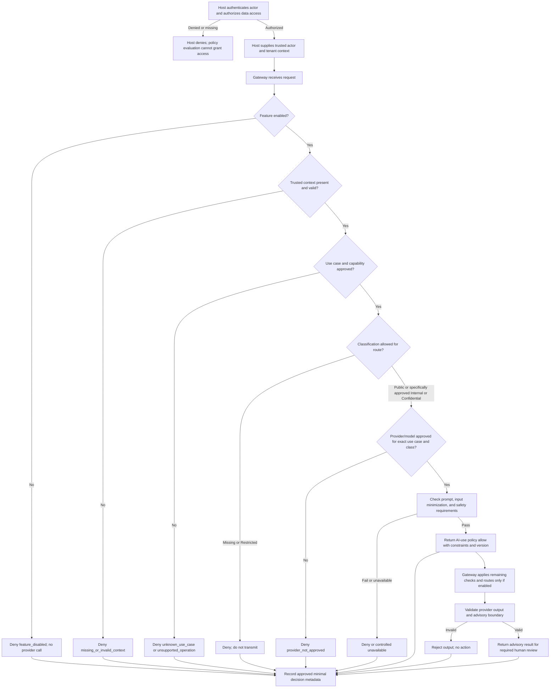

# Proposed Accidion AI Policy Engine

**Status: PROPOSED — NOT APPROVED**

This document proposes a policy-evaluation boundary for future Accidion AI use cases. It is documentation only; it does not authorize implementation, provider selection, data transmission, AI activation, or changes to ADR status. Accidion in-product AI Copilot remains disabled by default.

This proposal is subordinate to repository rules, `ai/SAFETY.md`, `ai/ARCHITECTURE.md`, the proposed Gateway contract in `ai/gateway/CONTRACTS.md`, the proposed provider interface in `ai/providers/PROVIDER_INTERFACE.md`, and any accepted ADRs. Proposed ADRs are not approvals.

## 1. Purpose

The Accidion AI Policy Engine is a proposed deterministic control point for deciding whether a specific AI use case may proceed under approved product policy. It evaluates AI-specific eligibility constraints such as feature state, use case, operation, data classification, approved provider/model profile, required context, and output restrictions.

The Policy Engine does **not** make Accidion identity or access decisions. The host platform remains authoritative for authentication, authorization, tenant access, deterministic IGA policy, segregation of duties (SoD), approvals, and workflow state. A policy-engine `allow` means only that an AI request satisfies the configured AI-use constraints; it is never permission to access an Accidion resource or execute an action.

## 2. Responsibilities and boundaries

### Responsibilities

If separately approved and implemented, the Policy Engine may:

- Evaluate whether the feature and requested AI use case are enabled under an approved policy version.
- Check that the operation is within `OBSERVE`, `REASON`, or `RECOMMEND`.
- Check required trusted host context is present and well formed; presence checks do not authenticate or authorize it.
- Enforce data-classification restrictions, including the prohibition on sending Restricted data to an AI provider.
- Confirm that a configured provider/model profile is explicitly approved for the exact use case, data classification, and processing conditions.
- Apply approved input, prompt, output-format, and response restrictions.
- Return a deterministic decision, stable reason codes, and the policy version used.
- Produce privacy-minimized decision metadata for the approved audit boundary.

### Boundaries

The Policy Engine must not:

- Authenticate actors or verify Accidion credentials.
- Decide whether an actor may access a tenant, subject, identity record, or other platform resource.
- Replace host authorization, deterministic IGA policy evaluation, SoD controls, workflow approvals, or target-side verification.
- Infer trusted actor or tenant context from prompts, request content, retrieved documents, or model output.
- Grant permission to a provider, model, route, or data destination absent a separate approval record.
- Convert an AI recommendation into a provisioning request, approval, policy change, or privileged execution.

Policy evaluation is not authorization. If host authorization is missing or denied, the host must not call the AI flow; an AI policy `allow` cannot override that result.

## 3. Supported AI use-case classification

Every proposed AI use case must be explicitly registered and approved before it can be eligible for evaluation. The registration should state its owner, purpose, user-visible behavior, allowed operation, input/output shape, permitted data classifications, provider/model profile approval reference (if applicable), feature state, and required human review.

The request's `use_case` and `operation` fields align with the Gateway contract. User input cannot create a new use case or elevate its operation. Unknown, unregistered, or unapproved use cases are denied.

The supported operation categories are:

| Capability | Meaning | Policy boundary |
| --- | --- | --- |
| `OBSERVE` | Summarize or report only the minimum host-authorized context supplied for the use case. | Must not broaden retrieval, infer access rights, or change state. |
| `REASON` | Analyze supplied authorized context and explain relevant factors or uncertainty. | Must not make authoritative identity, access, or policy decisions. |
| `RECOMMEND` | Offer a bounded advisory suggestion for an authorized human or existing workflow to consider. | Must not approve, provision, or directly trigger any action. |

These are capabilities, not authorization scopes. They do not give AI access to data and do not imply an approved product feature.

The policy catalog uses uppercase capability names; the Gateway request contract encodes the corresponding lowercase `operation` values: `OBSERVE` maps to `observe`, `REASON` maps to `reason`, and `RECOMMEND` maps to `recommend`. Any future implementation must use this explicit mapping and reject unknown values.

## 4. Allowed and prohibited capabilities

### Allowed only when separately approved and enabled

- `OBSERVE`, `REASON`, and `RECOMMEND` within a registered use case.
- Processing only the host-authorized, minimized context supplied for that request.
- Returning output that is advisory, validated, and subject to any required human review.

### Always prohibited by this proposal

- Autonomous access provisioning, deprovisioning, entitlement changes, or identity lifecycle actions.
- Autonomous approval or rejection of access requests, certifications, exceptions, or workflows.
- Privileged execution, arbitrary tool invocation, connector operation, or infrastructure mutation.
- Autonomous changes to access, security, tenant, or authorization policies.
- Bypassing SoD controls, deterministic policy evaluation, existing approval workflows, or target-side verification.
- Treating model or policy-engine output as an authorization decision or execution instruction.

Human approval alone does not grant AI authority. Any privileged operation outside AI, if supported by the host platform, requires independent server-side authentication, authorization, deterministic policy validation, and an approved workflow.

## 5. Data classification

The Policy Engine consumes the host platform's approved data-classification label; this proposal does not replace the platform's classification scheme or define its classification process. Provider eligibility is evaluated for the combination of use case, provider/model profile, data class, processing conditions, and approvals. An approved provider is **not** automatically approved for every classification.

| Classification | Proposed AI policy |
| --- | --- |
| `Public` | May be considered only for a registered, approved use case and an explicitly approved provider/model route. Minimize input and validate output. Public classification alone does not authorize processing. |
| `Internal` | May be considered only when the use case, provider/model profile, destination, retention, and safeguards are explicitly approved for Internal data. Use least-data input and privacy-aware audit. |
| `Confidential` | Deny by default. Processing may be considered only after explicit security, privacy/data-governance, architecture, and provider/data-processing approval for this exact use case and route. Apply approved minimization, redaction, and retention controls. |
| `Restricted` | Do not transmit to any AI provider. Deny provider processing regardless of model/provider approval, prompt instruction, user request, or human approval. A separately approved non-provider local handling design would require a distinct review and is outside this proposal. |

If classification is missing, unknown, ambiguous, or cannot be trusted as host-provided context, fail closed. Do not infer a less restrictive classification from prompt text, model output, or absence of sensitive-looking fields.

## 6. Tenant-isolation policy

- Host authentication and authorization establish the actor, tenant, and accessible data before an AI request is submitted.
- The Policy Engine may require trusted `tenant_ref`, `actor_ref`, caller identity, and host authorization-context reference to be present and structurally valid. It does not validate resource permissions or use these fields to grant access.
- Never trust tenant identifiers, actor identities, authorization claims, or policy claims in user prompts, request content, retrieved documents, or model responses.
- Missing, conflicting, or malformed context results in denial before provider routing.
- The host supplies only already-authorized context. The Policy Engine and provider adapter do not fetch or expand tenant data.
- Any later retrieval, cache, audit access, or background work must be tenant-scoped by trusted platform controls. No cross-tenant context or cache sharing is permitted.
- A model response cannot introduce tenant identifiers, source data, or references as authority.

## 7. Provider and model approval requirements

Provider/model approval is a separate governance decision and is evaluated per use case, classification, processing destination, and conditions. Before a route can be eligible, its approval record should cover:

- Provider and model identity, intended use, permitted use cases, and capability limits.
- Data categories and classification levels allowed for that exact route.
- Processing region, data residency, subprocessors, and cross-border transfer review.
- Data-processing terms, retention, deletion, training/secondary use, and support access.
- Security controls, transport, credential handling, operational monitoring, and incident handling.
- Required safety and evaluation evidence, known limitations, and version/change control.

The Policy Engine must deny when the approval is absent, expired, revoked, ambiguous, or does not match the request. Provider health or availability does not imply approval. No fallback to a different provider/model or data destination is allowed unless that specific route is independently approved and selected by trusted configuration.

## 8. Prompt and input restrictions

- Prompts, user instructions, retrieved content, tool results, and provider responses are untrusted data.
- Only reviewed prompt versions associated with an approved use case may be used. Prompt text cannot establish identity, tenant context, authorization, data classification, or policy.
- Reject requests that attempt to use prompts to override system policy, disclose secrets, change tenant context, bypass SoD/workflows, or trigger prohibited actions.
- Accept only minimum, host-authorized task context; do not allow arbitrary data retrieval instructions or broad tenant exports.
- Do not send secrets, credentials, private keys, access tokens, or unnecessary personal/identity attributes to providers.
- Apply approved input bounds, classification, minimization, and redaction controls before any provider routing.
- If an input safety or classification check is unavailable or inconclusive, deny or return a controlled unavailable result.

## 9. Output validation requirements

Provider output is untrusted. Before returning it, the Gateway/host integration must validate it against the registered use case's output format and safety rules. Policy constraints include:

- Output must remain within the requested `OBSERVE`, `REASON`, or `RECOMMEND` capability.
- Output must not claim an authorization, SoD evaluation, approval, provisioning, or state change unless the authoritative host workflow separately established that fact.
- Output must not introduce access to another tenant, unapproved source references, secrets, or protected data.
- Malformed, incomplete, out-of-scope, or unsafe output is rejected with a controlled failure/refusal; it is not repaired into a policy decision.
- Required validation unavailable means no result is returned as successful.
- Any human review requirement is explicitly represented in the use-case policy and communicated to the host; review never replaces authorization checks.

The Policy Engine's decision does not certify that model output is true or safe. The host must not use AI output directly as an executable command or provisioning trigger.

## 10. Human review requirements

Use-case registration must define whether and when qualified human review is required. At minimum:

- Recommendations affecting access, identity, security, or governance are advisory and must be considered within the existing accountable human/workflow process.
- AI output cannot approve or reject access requests, certifications, policy exceptions, or SoD outcomes.
- Human review is not an authorization token and cannot override server-side authentication, authorization, deterministic policy, or tenant isolation.
- Review outcomes and relevant policy decision references may be recorded as minimal audit metadata under approved platform controls.
- If a use case lacks its required human-review path, deny that use case.

## 11. Policy decision contract and denial behavior

The following is a logical policy decision shape, not an implemented API or final schema:

| Field | Meaning |
| --- | --- |
| `decision` | `allow` or `deny`; `allow` means only AI-use policy permits continuing to the next control. |
| `reason_codes` | Stable, non-sensitive reasons such as `feature_disabled`, `unknown_use_case`, `unsupported_operation`, `missing_trusted_context`, `unsupported_data_classification`, `restricted_data`, `provider_not_approved`, `human_review_required`, or `policy_unavailable`. |
| `policy_version` | Immutable version identifier for the policy set evaluated. |
| `evaluated_at` | Decision timestamp. |
| `constraints` | Applicable restrictions, such as allowed operation, permitted provider profile, output-format identifier, data-minimization rule, or human-review requirement. |

The policy engine denies or returns controlled unavailability when:

- Required host authentication/authorization context is absent, though it never performs those checks itself.
- Trusted actor or tenant context is missing, malformed, conflicting, or appears caller-controlled.
- Feature is disabled, use case is unknown/unapproved, or capability exceeds the approved boundary.
- Data classification is missing/unsupported or data is Restricted.
- Provider/model approval does not match the precise use case, classification, and processing conditions.
- Required prompt, input, output, or human-review controls are absent.
- Policy configuration is unavailable, invalid, stale, or cannot be evaluated deterministically.

No error, timeout, empty configuration, or ambiguous state may produce an `allow`. Denials should expose safe reason codes to the host and avoid revealing sensitive policy internals to an end user. A denial must prevent provider routing.

## 12. Feature flag and disabled-by-default behavior

The in-product Accidion AI Copilot and all AI use cases remain disabled by default. The disabled state is enforced by trusted host/Gateway configuration, not by a prompt, model, or user-supplied field.

When disabled:

- The AI request is denied with `feature_disabled`.
- No provider, retrieval, or model call occurs.
- No configuration presence, provider health, previous approval, user request, or evaluation result implicitly enables the feature.
- Only approved minimal metadata may be recorded through the platform audit boundary.

Enablement requires explicit product, security, privacy, architecture, and delivery approvals as applicable, plus a controlled release and rollback process. This document does not enable any capability.

## 13. Policy versioning and change approval

Policy sets and use-case registrations should be immutable, versioned artifacts with an owner, rationale, approval references, effective status, and change history. Every decision records the policy version used, without logging full prompts or sensitive input by default.

Changes to allowed operations, classifications, provider/model routes, prompt restrictions, human-review requirements, denial behavior, or feature defaults require documented review by the relevant product, security, privacy, architecture, and delivery owners. Changes affecting authentication, authorization, SoD, tenant isolation, public contracts, provider/data handling, dependencies, CI, or infrastructure also require the prior maintainer approval required by repository rules and any necessary ADR process.

Proposed policies remain proposed until explicitly approved. This document and its examples do not change ADR-007 or any other ADR status.

## 14. Synthetic policy decision examples

The examples are illustrative JSON only. Identifiers and content are synthetic; no provider, model, or runtime is implied.

### Deny: feature disabled

```json
{
  "decision": "deny",
  "reason_codes": ["feature_disabled"],
  "policy_version": "synthetic-policy-v1",
  "evaluated_at": "2026-11-10T07:20:00Z",
  "constraints": {
    "provider_call_permitted": false,
    "action_permitted": false
  }
}
```

### Deny: Restricted data

```json
{
  "decision": "deny",
  "reason_codes": ["restricted_data"],
  "policy_version": "synthetic-policy-v1",
  "evaluated_at": "2026-11-10T07:21:00Z",
  "constraints": {
    "data_classification": "Restricted",
    "provider_call_permitted": false,
    "action_permitted": false
  }
}
```

### Allow: approved synthetic advisory use case only

```json
{
  "decision": "allow",
  "reason_codes": [],
  "policy_version": "synthetic-policy-v1",
  "evaluated_at": "2026-11-10T07:22:00Z",
  "constraints": {
    "use_case": "synthetic-review-summary",
    "allowed_capability": "OBSERVE",
    "data_classification": "Public",
    "provider_profile_approval_ref": "approval-synthetic-042",
    "human_review_required": true,
    "provider_call_permitted": true,
    "action_permitted": false
  }
}
```

The `allow` example illustrates an AI-use policy decision only. The host must still authenticate and authorize the actor and data access; the example is not production policy, provider approval, or permission to enable Copilot.

## 15. Policy evaluation flow



## 16. Relationship with host platform authorization

The host Accidion platform remains authoritative for:

- Actor authentication and session/service identity.
- Tenant membership and tenant-scoped resource access.
- Authorization to access the data and invoke a host feature.
- Deterministic identity, access, SoD, and policy decisions.
- Request approvals, provisioning workflows, connector execution, and target-side verification.

The AI Policy Engine is a separate, narrower gate over whether an already-authorized request may use an approved AI use case and route. It consumes trusted host context but does not validate its authorization semantics, grant permission, or make decisions on Accidion resources. The Gateway must require both host authorization from the host flow and an AI-policy `allow`, then perform its own request/output controls. A failure or denial in either path blocks provider routing. Neither a model output, a human review, nor an AI-policy `allow` can override host authorization, SoD controls, or approval workflows.

This proposal does not define an implementation contract between the host authorization engine and a future policy evaluator. That integration and any changes to security boundaries require explicit architecture/security review and approval.
