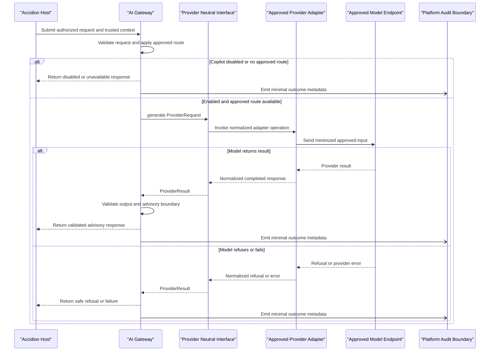

# Proposed Provider-Neutral AI Interface

**Status: PROPOSED — NOT APPROVED**

This document proposes a provider-neutral boundary between the Accidion AI Gateway and future provider adapters. It is design documentation only: it does not select or connect a provider, authorize data transmission, define runtime code, add dependencies, enable the product Copilot, or change any ADR status.

The interface is subordinate to repository rules, `ai/SAFETY.md`, `ai/ARCHITECTURE.md`, and the proposed Gateway contract in `ai/gateway/CONTRACTS.md`. Provider adapters and models are untrusted processing boundaries. The Gateway and host platform remain responsible for their respective controls.

## 1. Purpose of the provider abstraction

The abstraction keeps provider-specific APIs and response formats out of the Gateway and Accidion domain services. The Gateway submits a normalized request to an adapter and receives a normalized result, refusal, or error.

The abstraction is intended to:

- Allow an explicitly approved adapter to be added behind a stable Gateway-facing interface.
- Keep provider selection, credentials, endpoint details, and provider-specific options out of user requests and domain logic.
- Make adapter behavior testable without requiring live provider calls.
- Provide consistent capability, timeout, refusal, error, and version metadata.

This abstraction does not imply that any provider or model is approved, available, safe, or suitable for a data classification.

## 2. Provider adapter responsibilities

An adapter translates the provider-neutral request into the selected provider's approved protocol and normalizes its response. It may:

- Use only its explicitly approved provider configuration and credentials.
- Enforce adapter-level request bounds and supported capability constraints.
- Submit only the minimized content and metadata supplied by the Gateway.
- Apply the Gateway-provided deadline and cancellation signal where supported.
- Convert provider results, refusals, timeouts, throttling, and failures into the neutral response contract.
- Return provider/model version metadata when reliably available and approved for audit.

An adapter must not:

- Authenticate Accidion users, authorize access to Accidion data, evaluate IGA policy, or decide whether a tenant or actor may access a resource.
- Retrieve, expand, or fetch Accidion context, or follow model instructions to access another tenant.
- Change tenant or actor context, or treat user-supplied tenant identifiers as authority.
- Perform provisioning, approvals, access changes, privileged operations, or any other autonomous action.
- Select a provider, model, endpoint, data destination, or fallback based on caller-controlled request fields.
- Log raw prompts, responses, secrets, or identity data by default.

The host platform authorizes and scopes data before the Gateway is called. The Gateway applies its approved routing and safety policy. The provider adapter performs transport translation only; it is not an authorization or policy decision point.

## 3. Standard provider request interface

The logical interface is:

```text
ProviderAdapter.generate(ProviderRequest) -> ProviderResult
```

The following fields are a proposed provider-neutral shape, not a finalized serialization or public API:

| Field | Required | Meaning |
| --- | --- | --- |
| `interface_version` | Yes | Version of the provider-neutral adapter contract. |
| `request_id` | Yes | Opaque correlation identifier from the Gateway. Must not contain secrets or personal data. |
| `capability_profile` | Yes | Gateway-selected, approved capability profile; not a provider name or endpoint supplied by the caller. |
| `operation` | Yes | `observe`, `reason`, or `recommend`, consistent with the Gateway request. It never authorizes action execution. |
| `task` | Yes | Normalized task content, treated as untrusted input. |
| `context` | Yes | Minimum context already authorized and minimized by the host/Gateway. The adapter must not expand it. |
| `data_classification` | Yes | Host-assigned classification forwarded by the Gateway for the approved route. It does not grant permission to transmit or process data. |
| `output_format` | Yes | Approved, provider-neutral output shape identifier and any bounded schema instructions required by that profile. |
| `limits` | Yes | Gateway-supplied input/output bounds, including an output-token ceiling where supported. |
| `deadline` | Yes | Absolute deadline or remaining time budget imposed by the Gateway. |
| `cancellation` | Recommended | Cancellation signal associated with the Gateway request, where the implementation supports it. |

Trusted Accidion actor and tenant identities, host credentials, authorization tokens, and arbitrary resource references are not provider request fields. The provider has no Accidion data-access capability. If an approved adapter requires additional metadata, it must be narrowly specified and reviewed; it cannot be used to authorize access or widen data scope.

## 4. Standard provider response interface

The adapter returns exactly one normalized outcome:

| Field | Required | Meaning |
| --- | --- | --- |
| `interface_version` | Yes | Version of the provider-neutral adapter contract. |
| `request_id` | Yes | Echo of the originating request identifier for correlation. |
| `outcome` | Yes | `completed`, `refused`, or `error`. |
| `content` | Conditional | Provider output for `completed`, still untrusted and subject to Gateway validation. |
| `refusal` | Conditional | Provider refusal category and safe explanatory text for `refused`. |
| `error` | Conditional | Normalized error category and retryability for `error`; no raw provider body or sensitive details. |
| `capabilities_used` | Yes | Declared capabilities used for this call; must be a subset of the approved profile. |
| `provider_version` | Conditional | Stable provider identifier/version metadata, if available and approved for retention/audit. |
| `model_version` | Conditional | Exact model/version identifier, if available and approved for retention/audit. |
| `usage` | Conditional | Bounded operational usage metadata such as token counts, if available and approved. Must not include prompt or response content. |
| `duration_ms` | Yes | Adapter-observed elapsed time. |

The Gateway validates the response shape, request correlation, capability use, output bounds, and content against the approved use-case output contract. Provider output is never trusted as an authorization decision, policy result, approval, or completed operation.

## 5. Capability declaration

Each adapter exposes a declarative capability description for Gateway routing. It is descriptive metadata, not permission to use a feature:

| Capability | Meaning |
| --- | --- |
| Text generation | Whether the adapter can return bounded text for supported observe/reason/recommend use cases. |
| Structured output | Whether it can request a supported structured format; all returned structures still require Gateway-side validation. |
| Input limit | Maximum input size or token budget for the configured model profile. |
| Output limit | Maximum output size or token budget for the configured model profile. |
| Supported operations | The subset of observe/reason/recommend supported by the approved profile. |
| Supported classifications | The approved classifications that may be processed by that specific configured route. |
| Cancellation | Whether in-flight work can be cancelled when the Gateway deadline expires. |

Capabilities and limits are specific to an approved provider/model configuration and can change. They must be reported from controlled configuration or reliable provider metadata, not inferred from model output. A capability declaration cannot expand the Gateway's permitted use cases, data classes, or safety boundaries. Unknown or stale capability information fails closed.

## 6. Timeout and error contracts

The Gateway owns the end-to-end deadline and supplies the adapter a bounded budget. The adapter must not extend it. It should propagate cancellation where supported; if a remote operation cannot be cancelled, it must stop waiting at the deadline, discard late results, and report a timeout without starting an unsafe fallback.

Proposed normalized error categories:

| Category | Meaning | Retry guidance |
| --- | --- | --- |
| `deadline_exceeded` | The request budget elapsed. | Do not retry outside the original deadline. |
| `rate_limited` | Provider or adapter quota temporarily prevents processing. | Retry only if Gateway policy permits and budget remains. |
| `provider_unavailable` | The configured endpoint is unavailable or not ready. | No provider substitution; retry only under bounded Gateway policy. |
| `transport_error` | Network or protocol failure. | Retry only for classified transient failures within the budget. |
| `invalid_provider_response` | Response cannot be normalized or violates expected protocol. | Do not retry by default; Gateway must not accept malformed output. |
| `configuration_error` | Required approved configuration is absent or invalid. | Do not retry; fail closed and alert through approved operations. |
| `unsupported_capability` | Request exceeds the configured profile's capabilities. | Do not retry or silently change the request/profile. |
| `internal_error` | Unexpected adapter failure. | Safe generic failure; no sensitive details in response or logs. |

Retry decisions belong to the Gateway under its approved policy. Adapters must not create unbounded retries, switch models/providers, or return success-shaped fallback content. Refusals are a distinct `refused` outcome, not a retryable error.

## 7. Provider availability and health status

An adapter may expose status such as `ready`, `degraded`, or `unavailable`, with a timestamp and non-sensitive reason category. Status is advisory operational input to Gateway routing:

- `ready` means the approved configuration appears able to accept bounded requests; it does not guarantee success or safety.
- `degraded` means requests may fail or be delayed; the Gateway applies its approved policy and deadline.
- `unavailable` means the adapter should not be selected.
- Missing, stale, or invalid status is treated as unavailable.

Health checks must not send customer data, secrets, or unrestricted prompts. They must not call a different provider or expose endpoint credentials. Availability does not imply provider approval, Copilot enablement, or authorization to transmit a particular data classification.

## 8. Data classification restrictions

The host supplies authorized, minimized context and its approved classification label; the Gateway determines whether an approved route is permitted for the use case and classification. The adapter may enforce that its configured profile supports the classification, but it cannot approve the classification or override a Gateway denial.

- If classification is missing, unknown, unsupported, or inconsistent with the approved profile, reject before external transmission.
- Never infer classification from model output or user claims.
- Do not transmit secrets, credentials, tokens, private keys, or unnecessary personal/identity data.
- Process only data categories, use cases, regions, and retention conditions covered by the provider's separate approval.
- Do not use tenant data for training, retention, or secondary purposes unless separately reviewed and explicitly approved.
- Synthetic data is required for examples and evaluations unless a separate data-governance approval permits otherwise.

## 9. Provider configuration requirements

Configuration is controlled by the approved Accidion deployment/operations boundary, not by end-user requests, prompts, model output, or arbitrary request fields. A provider profile should identify, as applicable:

- The explicitly approved provider and model profile.
- Approved endpoint/region and transport security settings.
- Capability declarations and bounded input/output limits.
- Permitted use cases and data classifications.
- Timeout and operational health policy references.
- Data-processing, retention, and logging settings approved for the integration.
- Version metadata and change-control ownership.

Configuration changes that alter provider/model, endpoint, region, data categories, retention, or capability require the approvals applicable to provider, security, privacy, architecture, and operations decisions. This proposal sets no provider-specific property names or values.

## 10. Secret management requirements

- Never put API keys, credentials, access tokens, private keys, or secret values in this document, source code, examples, requests, responses, prompts, logs, or health output.
- An approved adapter obtains credentials only through the platform's approved secret-management mechanism with least privilege and appropriate rotation.
- Do not pass host authentication credentials or authorization tokens to providers.
- Redact secrets from errors and telemetry; do not include raw provider request/response bodies in logs.
- Missing, expired, or inaccessible credentials produce a controlled configuration/unavailable error and must not trigger an unapproved fallback.

The secret-management product, credential scope, rotation schedule, and deployment wiring are not selected here and require separate approval.

## 11. Model and provider version tracking

For each completed or refused request, retain only the provider/model identifiers and version metadata necessary for approved audit, evaluation reproducibility, and operations. Record the adapter/interface version and configured profile version where applicable.

- Prefer immutable model/version identifiers when the provider supports them.
- Distinguish configured version from a provider-reported version; do not claim exact version pinning if it cannot be verified.
- Treat provider-reported metadata as untrusted input and validate length/format before recording.
- Do not log prompts or responses as a substitute for version metadata.
- Version/profile changes require review and regression evaluation under the approved release process.
- Missing version data is recorded as unknown; it must not be fabricated.

Retention and access to version/audit metadata follow separately approved platform policies.

## 12. Provider selection and approval lifecycle

1. Identify an MVP-eligible use case and data classes; obtain product and delivery scope approval.
2. Assess candidate providers, models, data-processing terms, region, retention, training use, subprocessors, security, and operational constraints.
3. Obtain explicit architecture, security, privacy/legal, and operations approvals as applicable. Record material choices through the repository ADR/approval process; a proposed ADR or this document is not approval.
4. Define an approved provider profile, capability declaration, and allowed use-case/classification mapping outside user control.
5. Add an adapter behind this interface and test it with synthetic data, contract tests, failure cases, and safety evaluations before any enablement.
6. Release only through the approved human-controlled process. Keep the Accidion Copilot disabled by default; enablement requires separate explicit product/security governance and a controlled rollback path.
7. Reassess and reapprove material provider, model, endpoint, region, terms, capability, data-handling, or retention changes.

If no approved route is available, the Gateway returns a controlled unavailable result. The adapter and Gateway must not silently select a substitute.

## 13. Synthetic request and response examples

These are illustrative provider-interface payloads only. All values are synthetic. They do not identify or imply an actual provider or model.

### Request

```json
{
  "interface_version": "proposed-v1",
  "request_id": "req-synth-0042",
  "capability_profile": "profile-synthetic-summary",
  "operation": "observe",
  "task": "Summarize the supplied synthetic review status.",
  "context": {
    "review_status": "pending-human-review",
    "subject_label": "synthetic-subject-17"
  },
  "data_classification": "synthetic",
  "output_format": "access-review-summary-v1",
  "limits": {
    "max_input_tokens": 1200,
    "max_output_tokens": 180
  },
  "deadline": "2026-11-10T07:15:00Z",
  "cancellation": "cancel-synth-0042"
}
```

The capability profile and numeric limits are examples only, not approved configuration or a guarantee about any model.

### Response

```json
{
  "interface_version": "proposed-v1",
  "request_id": "req-synth-0042",
  "outcome": "completed",
  "content": {
    "summary": "Synthetic review 17 is pending human review."
  },
  "capabilities_used": [
    "text_generation",
    "structured_output"
  ],
  "provider_version": "synthetic-provider-profile-v1",
  "model_version": "synthetic-model-version-v1",
  "usage": {
    "input_tokens": 74,
    "output_tokens": 11
  },
  "duration_ms": 420
}
```

This response is untrusted until the Gateway validates it against the approved output contract. Its content is advisory and does not indicate authorization, approval, or action.

## 14. Provider interface sequence

<!-- mermaid-checked: every participant uses `participant Id as "Label"`, no \n in aliases/messages/notes, every alt/opt/loop closed by end, no `:` inside any alias -->


## 15. Adding future providers without changing Gateway contracts

A future provider is added by implementing the same adapter request/response interface, declaring its approved capabilities and supported data classifications, and mapping an explicitly approved Gateway profile to that adapter. The Gateway request and response contracts remain provider-neutral; provider-specific fields and protocol transformations stay inside the adapter.

The addition still requires provider/data-processing review, configuration and secret-management approval, contract and failure-mode tests, synthetic safety evaluations, version/change tracking, and a controlled release decision. If a candidate cannot meet the existing interface safely, do not leak provider-specific options into the Gateway contract as a shortcut; seek architecture approval for a deliberate contract revision. No provider may widen authorization, tenant scope, use-case permissions, or the observe/reason/recommend boundary.

## 16. Decisions requiring approval

Before implementing or enabling this interface, obtain the applicable approvals for:

- Provider-neutral schema serialization, versioning, capability metadata, and limits.
- Host/Gateway trust-boundary and adapter transport security.
- Provider, model, endpoint, region, data categories, data-processing terms, and retention.
- Secret-management mechanism, credential scope, rotation, and operational ownership.
- Health-check, timeout, retry, quota, audit, and incident behavior.
- Any dependency, SDK, API, data persistence, retrieval, infrastructure, or CI change.
- MVP use-case eligibility and any product Copilot enablement.

Until then, this document remains **PROPOSED — NOT APPROVED**. It does not authorize runtime implementation, provider connection, data transmission, AI activation, or changes to ADR status.
